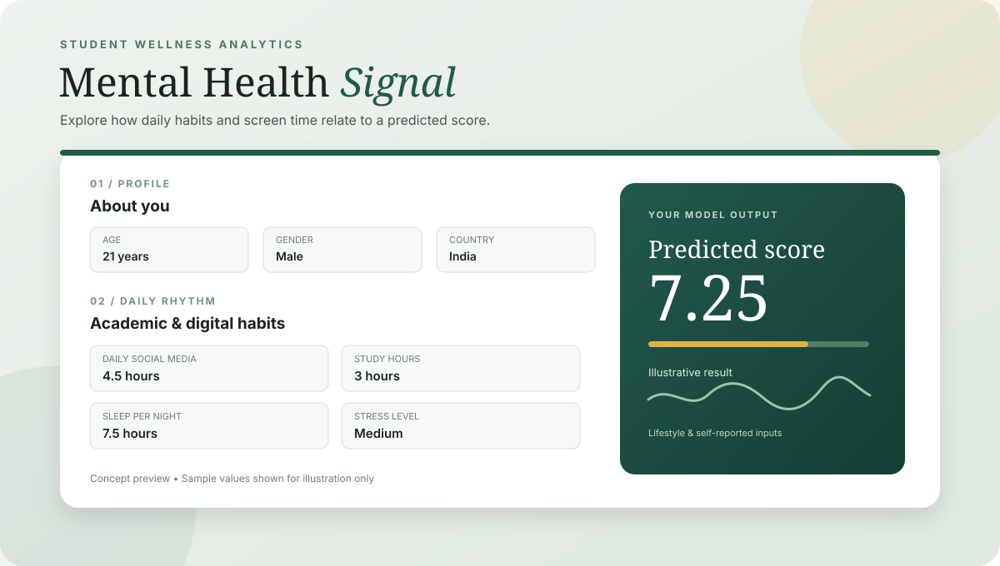

<div align="center">

# Mental Health Score Prediction

**Student wellness analytics powered by machine learning**

[](https://www.python.org/)
[](https://fastapi.tiangolo.com/)
[](https://scikit-learn.org/)
[](https://render.com/)

[**🚀 Open Live Demo**](https://mental-health-score-prediction-1-nsp6.onrender.com) · [**📓 Explore Notebook**](https://github.com/1kunal2006/Mental-Health-Score-Prediction/blob/main/mental_health_project.ipynb) · [**⚡ API Docs**](https://mental-health-score-prediction-1-nsp6.onrender.com/docs)

</div>

---

## Project Preview



<sub>Illustrative README preview with sample values; it is not a captured screenshot of the live application.</sub>

A machine learning project that predicts a student's mental health score from lifestyle, social media usage, academic, and demographic inputs. The project includes a data analysis and model-training notebook, a trained scikit-learn pipeline, and a web application for trying predictions.

> **Live demo:** [Mental Health Score Prediction on Render](https://mental-health-score-prediction-1-nsp6.onrender.com)

## Project Overview

The goal of this project is to explore how factors such as daily social media usage, number of phone unlocks, study time, physical activity, sleep, and self-reported stress relate to a student's mental health score.

The model returns a **predicted score**, not a diagnosis or clinical assessment. It should be used for educational and exploratory purposes only.

## Features

- Exploratory data analysis using Pandas.
- Data cleaning, including duplicate removal and handling negative physical-activity values.
- Feature engineering by grouping less frequent countries into an `Other` category.
- Preprocessing with `ColumnTransformer` and scikit-learn pipelines.
- Comparison of Linear Regression and Random Forest regression.
- Hyperparameter search with `RandomizedSearchCV` and 5-fold cross-validation.
- FastAPI prediction endpoint with request validation through Pydantic.
- Browser-based form for submitting inputs and viewing a predicted score.
- Deployment on Render.

## Dataset

The repository includes **Student Social Media And Mental Health Impact.csv**. The notebook reports 5,000 rows and 13 original columns before cleaning. After duplicate removal, 4,998 rows remained in the notebook's cleaning step.

Input features used by the model include:

- Age and gender
- Country and academic level
- Most-used social media platform
- Purpose of social media use
- Average daily usage hours and daily unlocks
- Study hours and physical activity hours
- Sleep hours per night
- Stress level

The target variable is `Mental_Health_Score`.

## Model Development

The analysis and training workflow is documented in `mental_health_project.ipynb`.

1. Explore the dataset and inspect its structure, summary statistics, and missing values.
2. Remove duplicate rows and clip negative physical-activity values to zero.
3. Group countries outside the selected top-country list into `Other`.
4. Split the data into training and test sets using a 70/30 split and `random_state=42`.
5. Build preprocessing pipelines:
   - Log transformation and standardization for `Study_Hours`
   - Standardization for other numeric features
   - Ordinal encoding for `Stress_Level`
   - One-hot encoding for categorical features
6. Train and compare Linear Regression and Random Forest models.
7. Use `RandomizedSearchCV` to explore Random Forest hyperparameters.

### Evaluation results

The following values are taken from the notebook's held-out test-set evaluation:

| Model | Test R² | Test MAE | Test RMSE |
|---|---:|---:|---:|
| Linear Regression | 0.7398 | 0.5362 | 0.6760 |
| Random Forest (default) | 0.8780 | 0.3465 | 0.4629 |
| Random Forest (tuned) | 0.8652 | 0.3687 | 0.4865 |

The default Random Forest performed best on the reported test-set metrics among these three results. The saved model artifact in the repository is the Random Forest pipeline.

*R² measures how much target variation the model explains on the test set; MAE and RMSE measure prediction error. These metrics describe performance on this dataset and do not establish clinical validity.*

## Tech Stack

- **Language:** Python
- **Data analysis:** Pandas, NumPy
- **Machine learning:** scikit-learn
- **Model persistence:** Joblib
- **API:** FastAPI, Pydantic, Uvicorn
- **Frontend:** HTML, CSS, JavaScript
- **Deployment:** Render

## Repository Structure

```text
.
├── Mental_Health_Model (1).pkl
├── Student Social Media And Mental Health Impact.csv
├── mental_health_project.ipynb
├── main.py
├── requirements.txt
├── index.html
├── style.css
└── script.js
```

- `mental_health_project.ipynb` — data exploration, preprocessing, training, and evaluation.
- `Mental_Health_Model (1).pkl` — serialized trained Random Forest pipeline used by the API.
- `main.py` — FastAPI application and prediction logic.
- `index.html`, `style.css`, `script.js` — web interface.
- `requirements.txt` — Python dependencies.
- `Student Social Media And Mental Health Impact.csv` — dataset used in the notebook.

## Run Locally

### 1. Clone the repository

```bash
git clone https://github.com/1kunal2006/Mental-Health-Score-Prediction.git
cd Mental-Health-Score-Prediction
```

### 2. Create and activate a virtual environment (recommended)

```bash
python -m venv .venv
```

On Windows:

```bash
.venv\Scripts\activate
```

On macOS/Linux:

```bash
source .venv/bin/activate
```

### 3. Install dependencies

```bash
pip install -r requirements.txt
```

### 4. Start the application

```bash
uvicorn main:app --reload
```

Open [http://127.0.0.1:8000](http://127.0.0.1:8000) in your browser. FastAPI's interactive API documentation is available at [http://127.0.0.1:8000/docs](http://127.0.0.1:8000/docs).

Keep the trained model file in the repository root alongside `main.py`; the application loads it when the server starts.

## API

### `POST /predict`

Submit a JSON object containing the student inputs. The API validates the values and returns a predicted mental health score.

Example request:

```json
{
  "age": 21,
  "gender": "Male",
  "country": "India",
  "academic_level": "Undergraduate",
  "most_used_platform": "Instagram",
  "purpose_of_use": "Education",
  "avg_daily_usage_hours": 4.5,
  "daily_unlocks": 100,
  "study_hours": 3.0,
  "physical_activity_hours": 1.0,
  "sleep_hours_per_night": 7.5,
  "stress_level": "Medium"
}
```

Example response shape:

```json
{
  "predicted_mental_health_score": 7.25
}
```

The response number above is illustrative; the actual prediction depends on the submitted inputs and loaded model.

## AI Assistance & Credits

- **Machine learning and analysis:** The data exploration, preprocessing, feature engineering, model training, model comparison, hyperparameter search, and evaluation work documented in the notebook were completed by me.
- **Frontend assistance:** Claude was used to help create the frontend files: `index.html`, `style.css`, and `script.js`.
- **Deployment:** Render is used to host the application.

This project combines my own machine-learning work with AI-assisted frontend development.

## Limitations

- Predictions reflect patterns learned from the available dataset and may not generalize to other populations.
- The dataset and its labels may contain limitations or bias that are not captured by the evaluation metrics.
- A predicted score is not a mental-health diagnosis and should not be used as a substitute for advice from a qualified professional.

## Author

**Kunal** — [GitHub profile](https://github.com/1kunal2006)

---

If you find this project useful, feel free to explore the notebook, review the implementation, or try the live demo.
